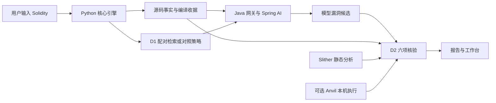

# VeriRAG：让智能合约审计结论有据可查

VeriRAG 是一个基于安全条件差异检索 D1 与路径覆盖多义务验证 D2 的智能合约审计 Agent 系统：大模型提出漏洞猜想，程序分析与本机执行提供判断依据，研究者可以沿着保存的记录复核结果。

## 用一分钟了解项目

智能合约管理资产和权限，错误的调用顺序或权限检查可能造成严重后果。大模型擅长理解代码和参考案例，也可能给出不存在的漏洞；静态工具能发现风险模式，但一条告警未必说明风险在实际业务中成立。VeriRAG 尝试让两者配合：先给模型提供漏洞与修复的对照，再逐项检查它的猜想。

D1 关注修复前后的保护条件变化，例如“先付款再扣余额”与“先扣余额再付款”。D2 检查同一猜想涉及的调用者、资产、检查顺序、其他入口、状态版本和绕过路径。最终报告给出“支持、反驳、未知”，同时说明依据和缺口。

当前重点是访问控制与重入两类漏洞。Java 21 网关使用 Spring AI 调用模型，Python 组织检索、源码分析、Slither 静态检查与可选的本机 EVM 执行。工作台让读者查看候选、定位源码和导出报告。CLI 是命令行程序，本机网页由 Python 提供。

## 系统全景

模型模式经过 Java 网关；离线演练使用保存候选，直接进入核验流程。Anvil 只在显式启用且满足输入条件时参与。调用细节见 [技术设计](TECH_DESIGN.md)。

## 当前能做什么，研究还缺什么

截至 2026-10-14 已登记的工程结果，工作台、固定候选重放与有限 D2 核验能够运行。最新 163 条历史候选重新检查后为 82 条支持、0 条反驳、81 条未知；旧 133 条为 75／0／58，历史 151 条为 80／0／71。这些结果说明核验覆盖增加。

研究仍是部分完成、尚未验证：旧 133 条候选的未知数量未达到最多 13 条的目标；真实维护者修复尚未形成完整的漏洞支持／修复反驳对照；独立标签与精确模型文本预算的公平性也未完成核验。模型发现 F1 与这些核验结果分开呈现，详见 [实验现状看板](releases/R2-20261010/attachments/EXPERIMENT_DASHBOARD.md)。

本轮首期工程之后的一次真实采集也已完成：159 次正式请求，158 个模型结果有效、1 个格式失败；52 个共同目标的 F1 为只读源码 0.9792、相似案例 0.9684、D1 配对 0.9787。163 条新候选为 83 条支持、0 条反驳、80 条未知。源码一致，但采集跨三个构建产物阶段；这组新候选与上面的固定候选重放分别统计。具体结果和限制见 [本次真实报告](releases/R2-20261010/experiments/2026-10-14_SYNAPSE_REAL_API_REPORT.md)。

## 唯一文档地图

2026-10-19 已完成 **phase 4：访问控制事实引导与双向证据核验**的[ACTaint 分析](releases/phase4-20261019/ACTAINT_ANALYSIS.md)与[优化计划](releases/phase4-20261019/IMPLEMENTATION_PLAN.md)。计划先统一敏感操作定位，再补权限状态关系和有限保护证明。用户已授权按计划实施；首个小版本已统一七项历史转账候选的调用定位，详见[验收记录](releases/phase4-20261019/VERIFICATION.md)。权限事实、有限转账保护、执行失败分类和四条件设施已接入。用户另授权一次真实 API 实验；无付费预检完成，四个超限目标共同阻断，计费入口变化待明确，当前尚未新增真实模型调用。真实修复和独立研究限制继续有效。

2026-10-16 已接入 R3 首期机制卡片、多路召回、资源条件过滤和互补选择实验。一次五条件批量的 40 个模型请求全部有效，五条件 F1 均为 1.0，没有观察到分类增益；完整流程 33 项完成、7 项风险绑定失败。22 条新候选为 10 支持、0 反驳、12 未知。卡片未独立审核，真实修复配对与精确预算仍有缺口，正式研究保持未验证。结果见 [R3 实施与真实实验报告](releases/R3-20261015/experiments/2026-10-16_R3_IMPLEMENTATION_AND_REAL_API_REPORT.md)。

这是项目唯一的完整导航地图。下面按读者要解决的问题组织入口。`docs/README.md` 只把读者引到本页；最近已实施能力来自 phase 3，当前新规划为 phase 4，原有系统边界及未完成的真实修复任务继续引用 phase 2，历史版本保留在原目录。

接手开发时，先读根目录 [Agent 工作约定](../../AGENTS.md)，再读本页与[当前进度](PROGRESS.md)首屏，按任务进入下方的规格、计划或验收。规则文件维护工作边界，本页维护导航，进度页维护当前状态，技术设计维护实际实现；各版本的需求、目标方案、任务和验收仍由对应版本文档分别维护。

### 阶段名称与历史路径

从 2026-10-19 起，显示名称采用 `phase X：具体工作`。phase 4 就是原称 R4，没有额外增加一个版本；旧目录与实验编号保留，以免破坏证据引用。此处的 phase 表示工作版本，Planning／Building 等才表示工作流执行状态。

| 显示名称 | 历史别名与目录 | 状态说明 |
|---|---|---|
| phase 0：需求与架构探索 | R0；`releases/R0-20260918/` | 历史提案 |
| phase 1：审计原型与实验基线 | R1；`releases/R1/` | 历史工程与实验 |
| phase 2：差分检索与路径证据核验 | R2；`releases/R2-20261010/` | 已有能力与未完成的真实修复任务 |
| phase 3：机制卡片与多路检索 | R3；`releases/R3-20261015/` | 首期已实施，整体部分完成，研究尚未验证 |
| phase 4：访问控制事实引导与双向证据核验 | 原称 R4；`releases/phase4-20261019/` | 工程部分完成；调用定位、权限事实、有限证明与比较设施已接入，真实修复与独立研究待完成 |

### 第一层：5 分钟理解系统

| 想了解什么 | 阅读入口 |
|---|---|
| 项目目标、系统全景、当前能力 | 本页；[当前进度](PROGRESS.md) |
| D1、D2、三策略、四臂、状态含义 | [概念速查与 SimpleDAO 故事](releases/R2-20261010/attachments/CONCEPTS_AND_WALKTHROUGH.md) |
| 论文结果已经证明了什么 | [实验现状看板](releases/R2-20261010/attachments/EXPERIMENT_DASHBOARD.md) |

### 第二层：运行系统与理解实现

| 想完成什么 | 阅读入口 |
|---|---|
| 确认 Agent 的规则入口和修改边界 | [根目录 AGENTS.md](../../AGENTS.md)：当前唯一项目规则入口；保留中文、当前目录开发、提交同步、凭证和原件约束 |
| 用三条命令启动演示 | [快速上手](releases/R2-20261010/attachments/GETTING_STARTED.md) |
| 看数据流、时序和源码职责 | [技术设计](TECH_DESIGN.md) |
| 了解当前版本要解决的问题 | [R2 需求基线](releases/R2-20261010/PROJECT_BRIEF.md)、[行为规格](releases/R2-20261010/SPEC.md) |
| 区分设计目标与实际实现 | [目标方案](releases/R2-20261010/PROPOSED_DESIGN.md)、[统一实施计划](releases/R2-20261010/IMPLEMENTATION_PLAN.md) |
| 核对功能检查与已知限制 | [统一验收](releases/R2-20261010/VERIFICATION.md) |
| 深入使用命令行工具 | [工具说明](../../tools/experiment/README.md) |
| 找数据和测试材料 | [数据总入口](../../data/README.md)、[来源登记](../../data/datasets.json)、[R1 数据](../../data/audit/r1/)、[R2 清单与候选](../../data/audit/r2/)、[测试夹具](../../tools/experiment/fixtures/) |

### 第三层：实验、论文与复现

| 问题或记录 | 阅读入口及用途 |
|---|---|
| ACTaint 对下一阶段有什么启发 | [phase 4 文献与工程分析](releases/phase4-20261019/ACTAINT_ANALYSIS.md)、[统一优化计划](releases/phase4-20261019/IMPLEMENTATION_PLAN.md)：纠正六类操作、全文提示和实验口径；安排定位、权限事实、保护证明及独立评价；实际进展见[验收记录](releases/phase4-20261019/VERIFICATION.md) |
| 开题的实验设计与稿件审查怎样使用技能 | [本机开题工作流与技能配置](../../thesis/开题工作流评审与Skill配置_20260922.md#七2026-10-16补充实验设计与稿件审查)：2026-10-16 补充两个固定版本技能；开题材料与安装登记不随 Git 同步，安装不代表方法有效或独立审核完成 |
| 当前实验对照与论文主张边界 | [实验看板](releases/R2-20261010/attachments/EXPERIMENT_DASHBOARD.md)：共同目标 F1、候选未知率、研究缺口 |
| 怎样评价检索算法与生成依据 | [Ragas 接入与评估口径](releases/R2-20261010/attachments/RAG_EVALUATION.md)：人工相关性排序、可选语义评分、命令与论文边界 |
| 凭证、调用、锁与证据管理 | [合规与运行审计规范](releases/R2-20261010/attachments/OPERATIONS_AND_REPRODUCIBILITY.md)：集中解释运行约束与历史身份 |
| 真实项目漏洞与维护者修复 | [真实案例先导](releases/R2-20261010/attachments/REAL_CASE_PILOT.md)：来源与修复覆盖 |
| SYNAPSE 文献和本项目关系 | [文献对照](releases/R2-20261010/attachments/SYNAPSE_REVIEW_20261014.md)、[实施任务](releases/R2-20261010/IMPLEMENTATION_PLAN.md#synapse-优化任务) |
| Vul-RAG 启发与当前优化 | [R3 文献与源码分析](releases/R3-20261015/VUL_RAG_ANALYSIS.md)、[R3 统一实施计划](releases/R3-20261015/IMPLEMENTATION_PLAN.md)：首期卡片、多路检索、条件绑定、互补选择与评价；2026-10-16 已授权实施及一次探索批量，正式研究尚未通过准入 |
| 2026-10-16 R3 首期实施与采集 | [实施与真实实验报告](releases/R3-20261015/experiments/2026-10-16_R3_IMPLEMENTATION_AND_REAL_API_REPORT.md)：40/40 请求有效、五条件同为 F1 1.0；源码与 JAR 身份、卡片预算、原件及研究限制 |
| 2026-10-11 有限引擎接入 | [S11／S12 工程报告](releases/R2-20261010/S11_S12_ENGINE_REPORT.md) |
| 2026-10-11 三策略采集 | [原三策略报告](releases/R2-20261010/experiments/2026-10-11_API_BATCH_REPORT.md) |
| 2026-10-12 根因修复 | [零模型修复报告](releases/R2-20261010/experiments/2026-10-12_D1_D2_REPAIR_REPORT.md) |
| 2026-10-12 第二次采集 | [真实复验报告](releases/R2-20261010/experiments/2026-10-12_API_REVALIDATION_REPORT.md) |
| 2026-10-12 AST 升级后的采集 | [AST 复验报告](releases/R2-20261010/experiments/2026-10-12_AST_API_REVALIDATION_REPORT.md) |
| 2026-10-12 思考模式与全文输入 | [全文输入报告](releases/R2-20261010/experiments/2026-10-12_THINKING_FULLSOURCE_API_REPORT.md) |
| 2026-10-13 当时的研究差距 | [差距审查](releases/R2-20261010/RESEARCH_GAP_REVIEW_20261013.md)：历史诊断，后续结果见进度 |
| 2026-10-13 两批固定候选重放 | [离线工程报告](releases/R2-20261010/experiments/2026-10-13_STAGE1_5_OFFLINE_REPORT.md) |
| 2026-10-13 新模型采集 | [真实 API 报告](releases/R2-20261010/experiments/2026-10-13_STAGE1_5_REAL_API_REPORT.md)：当时新 163 条全部未知 |
| 2026-10-14 同编译证据重放 | [SYNAPSE 实施报告](releases/R2-20261010/experiments/2026-10-14_SYNAPSE_IMPLEMENTATION_REPORT.md)：同 163 条得到 82 支持／81 未知 |
| 2026-10-14 首期实施后的真实采集 | [真实 API 报告](releases/R2-20261010/experiments/2026-10-14_SYNAPSE_REAL_API_REPORT.md)：159 正式请求，新 163 条为 83 支持／80 未知，构建身份分段保存 |
| 原件分类与本机空间 | [原件说明](../../research-artifacts/README.md)、[存储整理报告](releases/R2-20261010/STORAGE_LAYOUT_REPORT.md) |
| 原始证据与历史正文 | [.evidence/R1](../../.evidence/R1/)、[迁移清单](../../.evidence/document-layout/manifest.json)、[R2 证据](../../.evidence/R2-20261010/)；部分材料仅本机保存 |

### 历史版本与重要决定

R0 是最初提案与旧源码调查；R1 是上一阶段的工程和实验记录。阅读历史时按文件日期理解状态，当前运行方式以技术设计与快速上手为准。历史正文与原实验表保持原样。

| 历史资料 | 入口 |
|---|---|
| R0 的目标、设计与交付路线 | [基线](releases/R0-20260918/PROJECT_BRIEF.md)、[设计](releases/R0-20260918/PROPOSED_DESIGN.md)、[交付计划](releases/R0-20260918/DELIVERY_PLAN_PROPOSAL.md) |
| R0 的实验、审查、验收和旧源码 | [实验协议](releases/R0-20260918/EXPERIMENT_PROTOCOL.md)、[审查](releases/R0-20260918/REVIEW.md)、[验收](releases/R0-20260918/VERIFICATION.md)、[源码调查](releases/R0-20260918/SOURCE_SURVEY.md) |
| R1 的完整版本记录 | [基线](releases/R1/PROJECT_BRIEF.md)、[规格](releases/R1/SPEC.md)、[设计](releases/R1/PROPOSED_DESIGN.md)、[计划](releases/R1/IMPLEMENTATION_PLAN.md)、[审查](releases/R1/REVIEW.md)、[验收](releases/R1/VERIFICATION.md) |
| R1 的知识与数据准备 | [知识库准备](releases/R1/attachments/D1_KB_READINESS.md)、[数据选取提案](releases/R1/attachments/DATASET_SELECTION_PROPOSAL.md)、[首批核对](releases/R1/attachments/FIRST_BATCH_AUDIT.md)、[首批划分](releases/R1/attachments/FIRST_BATCH_SPLIT.md) |
| R1 的研究、架构与界面 | [研究设计](releases/R1/attachments/RESEARCH_DESIGN.md)、[论文架构](releases/R1/attachments/THESIS_ARCHITECTURE.md)、[本机页面](releases/R1/attachments/LOCAL_UI.md)、[Milvus 试跑](releases/R1/attachments/MVP_MILVUS_RUN.md) |
| R1 的架构配图原件 | [交互图](releases/R1/attachments/assets/SYSTEM_ARCHITECTURE.html)、[图源](releases/R1/attachments/assets/SYSTEM_ARCHITECTURE.archify.json)、[历史截图](releases/R1/attachments/assets/thesis-architecture-20261004.png) |
| R1 的真实实验 | [2026-10-10 API 报告](releases/R1/experiments/2026-10-10_API_BATCH_REPORT.md) |
| 审计范围与配置问题 | [单次审计范围决定](decisions/DEC-001_SINGLE_AUDIT_SCOPE.md)、[配置固定问题调查](bugs/BUG-001_CONFIGURATION_SNAPSHOT.md) |

## 文档维护方式

`PROJECT.md` 维护完整地图，`PROGRESS.md` 记录当前能力与下一步，`TECH_DESIGN.md` 解释实际实现。每轮版本文档放在对应阶段目录；仅做后续优化规划时沿用“分析＋统一计划”，实际开工再按已确认范围维护必要规格与验收。小任务统一进入实施计划和进度，不另建一套文档。显示名称使用上表的 phase 命名，历史文档正文与原件身份保留。

历史报告保存当时的实验口径，后续重放单独写报告并相互链接。术语先用中文说明再给代码标识，实验结论始终说明样本分母和适用范围。具体写作规则见 [AGENTS](../../AGENTS.md)。
