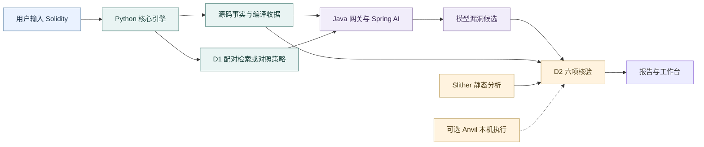

# VeriRAG：让智能合约审计结论有据可查

VeriRAG 是一个基于安全条件差异检索 D1 与路径覆盖多义务验证 D2 的智能合约审计 Agent 系统：大模型提出漏洞猜想，程序分析与本机执行提供判断依据，研究者可以沿着保存的记录复核结果。

## 用一分钟了解项目

智能合约管理资产和权限，错误的调用顺序或权限检查可能造成严重后果。大模型擅长理解代码和参考案例，也可能给出不存在的漏洞；静态工具能发现风险模式，但一条告警未必说明风险在实际业务中成立。VeriRAG 尝试让两者配合：先给模型提供漏洞与修复的对照，再逐项检查它的猜想。

D1 关注修复前后的保护条件变化，例如“先付款再扣余额”与“先扣余额再付款”。D2 检查同一猜想涉及的调用者、资产、检查顺序、其他入口、状态版本和绕过路径。最终报告给出“支持、反驳、未知”，同时说明依据和缺口。

当前重点是访问控制与重入两类漏洞。Java 21 网关使用 Spring AI 调用模型，Python 组织检索、源码分析、Slither 静态检查与可选的本机 EVM 执行。工作台让读者查看候选、定位源码和导出报告。CLI 是命令行程序，本机网页由 Python 提供。

## 系统全景

模型模式经过 Java 网关；离线演练使用保存候选，直接进入核验流程。Anvil 只在显式启用且满足输入条件时参与。调用细节见 [技术设计](TECH_DESIGN.md)。

## 当前能做什么，研究还缺什么

**截至 2026-10-21，已实施至 phase 5 的离线工程设施，工程部分完成（PARTIAL），研究效果尚未验证（UNVERIFIED）。** 工作台、Java 模型网关、固定候选重放与有限 D2 核验已经接通。phase 3 增加机制卡片与多路检索，phase 4 修复七项历史转账定位失败，并接入可选权限事实提示与有限转账保护证明。这些新增能力各有开关和适用范围，见[技术设计](TECH_DESIGN.md#默认流程与研究开关)。

phase 5 已依据[CF-RAG 分析](releases/phase5-20261021/CF_RAG_ANALYSIS.md)和[统一计划](releases/phase5-20261021/IMPLEMENTATION_PLAN.md)实现对照问题、同池两种排序、来源回放及独立评价设施。8 个历史目标登记 46 个操作，13 个结构有效；这 13 个单元均因完整材料超出固定本机编码器上限而失败，33 个未支持。真实排序成绩为空，零真实模型请求；结果与核心代码见[phase 5 验收](releases/phase5-20261021/VERIFICATION.md)。

最近两次探索均未观察到模型分类增益：2026-10-16 的五条件在八个开发目标上，F1（综合衡量报告准确程度与漏报情况的指标）均为 1.0000；2026-10-20 的四条件只有四个共同有效目标，F1 均为 1.0，另四目标的 16 个计划单元因输入超限而未请求。后一批产生 12 条候选，8 条支持、4 条未知。小规模开发集满分不能证明新增方法更好，也不能代替独立评价。

真实维护者修复仍是关键缺口：RabbitHole 与 Atomic 修复前后均实际核验，最终都是未知／未知。候选独立标签、知识语义审核和精确 token 预算公平性尚未完成。历史三策略、固定候选重放与最新探索的完整分母分别见[实验总览](releases/R2-20261010/attachments/EXPERIMENT_DASHBOARD.md)，当前任务见[进度](PROGRESS.md)。

## 论文应当怎样讲这项研究

| 叙述顺序 | 需要说明的内容 |
|---|---|
| 问题背景 | 模型猜想可能缺乏依据，工具告警也需要结合实际程序判断 |
| 现有方法不足 | 相似代码未必具有相同保护条件；局部检查不能说明其他入口和状态都受保护 |
| 项目思路 | D1 提供差异参考，模型生成可定位猜想，D2 检查程序依据并保留未知 |
| 系统实现 | Java 管理模型协议，Python 组织源码、检索、工具、核验与报告 |
| 实验评价 | 分别衡量模型发现、候选裁决覆盖、运行失败和真实修复对照 |
| 局限 | 开发集规模小，独立审核不足，语义覆盖有限，尚未证明方法普遍增益 |

这些是写作主线，不能自动当作两个已经成立的创新点。沿用[第二轮查新与立题裁决](../../thesis/D1_D2第二轮查新与立题裁决_20260924.md)：D1 的最窄研究方向谨慎推进；D2 宽版本已撤回独立创新主张。查新文件与[论文写作及答辩材料指引](../../thesis/论文写作与答辩材料指引_20261020.md)按约定仅在本机保存。

## 唯一文档地图

这是项目唯一的完整导航地图。先读本页与概念案例，可建立 5 分钟全景；再读技术设计和实验总览，目标是在 15 分钟内找到方法、实现、主要结果与限制。表中的旧目录名用于保留历史引用，不能据此认定系统仍停留在该阶段。

接手开发时先读根目录 [Agent 工作约定](../../AGENTS.md)与[当前进度](PROGRESS.md)首屏。下表和后续地图覆盖全部 62 份 `docs/` Markdown；[简短文档入口](../README.md)只引导到本页。本文维护导航，进度页维护当前状态，技术设计解释实际实现，各阶段计划和验收保留各自职责。

### 阶段名称与历史路径

从 2026-10-19 起，显示名称采用 `phase X：具体工作`。phase 4 就是原称 R4，没有额外增加一个版本；旧目录与实验编号保留，以免破坏证据引用。此处的 phase 表示工作版本，Planning／Building 等才表示工作流执行状态。

| 显示名称 | 历史别名与目录 | 状态说明 |
|---|---|---|
| phase 0：需求与架构探索 | R0；`releases/R0-20260918/` | 历史提案 |
| phase 1：审计原型与实验基线 | R1；`releases/R1/` | 历史工程与实验 |
| phase 2：差分检索与路径证据核验 | R2；`releases/R2-20261010/` | 已有能力与未完成的真实修复任务 |
| phase 3：机制卡片与多路检索 | R3；`releases/R3-20261015/` | 首期已实施，整体部分完成，研究尚未验证 |
| phase 4：访问控制事实引导与双向证据核验 | 原称 R4；`releases/phase4-20261019/` | 工程部分完成，已完成一次四条件探索；真实修复与独立研究待完成 |
| phase 5：对照查询与证据区分度重排 | `releases/phase5-20261021/` | 开发中（BUILDING），首期离线设施已实施；本机评分受长度阻断，独立审核和研究增益尚缺 |

### 第一层：5 分钟理解系统

| 想了解什么 | 阅读入口 |
|---|---|
| 项目目标、系统全景、当前能力 | 本页；[当前进度](PROGRESS.md) |
| D1、D2、三策略、四臂、状态含义 | [概念速查与 SimpleDAO 故事](releases/R2-20261010/attachments/CONCEPTS_AND_WALKTHROUGH.md) |
| 论文结果已经证明了什么 | [实验现状看板](releases/R2-20261010/attachments/EXPERIMENT_DASHBOARD.md) |

### 第二层：运行系统与理解实现

| 想完成什么 | 阅读入口 |
|---|---|
| 确认 Agent 的规则入口和修改边界 | [根目录 AGENTS.md](../../AGENTS.md)：当前唯一项目规则入口；保留中文、当前目录开发、提交同步、凭证和原件约束 |
| 用三条命令启动演示 | [快速上手](releases/R2-20261010/attachments/GETTING_STARTED.md) |
| 看数据流、时序和源码职责 | [技术设计](TECH_DESIGN.md) |
| 了解当前阶段与沿用的基础需求 | [phase 5 计划](releases/phase5-20261021/IMPLEMENTATION_PLAN.md)、[phase 5 验收](releases/phase5-20261021/VERIFICATION.md)；已有证明能力见 [phase 4 计划](releases/phase4-20261019/IMPLEMENTATION_PLAN.md)、[phase 4 验收](releases/phase4-20261019/VERIFICATION.md)；基础行为见 [R2 需求基线](releases/R2-20261010/PROJECT_BRIEF.md)、[行为规格](releases/R2-20261010/SPEC.md) |
| 区分基础设计目标与实际实现 | [phase 2 目标方案](releases/R2-20261010/PROPOSED_DESIGN.md)、[统一实施计划](releases/R2-20261010/IMPLEMENTATION_PLAN.md) |
| 核对基础功能的历史检查与限制 | [phase 2 统一验收](releases/R2-20261010/VERIFICATION.md) |
| 深入使用命令行工具 | [工具说明](../../tools/experiment/README.md) |
| 找数据和测试材料 | [数据总入口](../../data/README.md)、[来源登记](../../data/datasets.json)、[R1 数据](../../data/audit/r1/)、[R2 清单与候选](../../data/audit/r2/)、[测试夹具](../../tools/experiment/fixtures/) |

### 第三层：实验、论文与复现

| 问题或记录 | 阅读入口及用途 |
|---|---|
| CF-RAG 对 phase 5 有什么启发 | [文献与工程分析](releases/phase5-20261021/CF_RAG_ANALYSIS.md)、[统一优化计划](releases/phase5-20261021/IMPLEMENTATION_PLAN.md)：核对论文与作者代码，纠正直接相减和强制分支隔离等误读；已实现有来源的对照查询、同池重排和独立评价设施；[实际结果](releases/phase5-20261021/VERIFICATION.md)保留编码阻断及空成绩 |
| ACTaint 对 phase 4 有什么启发 | [phase 4 文献与工程分析](releases/phase4-20261019/ACTAINT_ANALYSIS.md)、[统一优化计划](releases/phase4-20261019/IMPLEMENTATION_PLAN.md)：纠正六类操作、全文提示和实验口径；安排定位、权限事实、保护证明及独立评价；实际进展见[验收记录](releases/phase4-20261019/VERIFICATION.md) |
| 2026-10-20 phase 4 实施与采集 | [实施与真实实验报告](releases/phase4-20261019/experiments/2026-10-20_IMPLEMENTATION_AND_REAL_API_REPORT.md)：16/16 请求有效、另 16 单元输入阻断；四条件 F1 相同，12 条候选为 8 支持／4 未知；用量、身份、原件与研究限制 |
| 开题的实验设计与稿件审查怎样使用技能 | [本机开题工作流与技能配置](../../thesis/开题工作流评审与Skill配置_20260922.md#七2026-10-16补充实验设计与稿件审查)：2026-10-16 补充两个固定版本技能；开题材料与安装登记不随 Git 同步，安装不代表方法有效或独立审核完成 |
| 论文章节、代码、证据与答辩问题 | [本机论文写作与答辩材料指引](../../thesis/论文写作与答辩材料指引_20261020.md)：逐章材料、可写主张、尚缺证据及配图用途；不随 Git 同步 |
| 当前实验对照与论文主张边界 | [实验看板](releases/R2-20261010/attachments/EXPERIMENT_DASHBOARD.md)：共同目标 F1、候选未知率、研究缺口 |
| 怎样评价检索算法与生成依据 | [Ragas 接入与评估口径](releases/R2-20261010/attachments/RAG_EVALUATION.md)：人工相关性排序、可选语义评分、命令与论文边界 |
| 凭证、调用、锁与证据管理 | [合规与运行审计规范](releases/R2-20261010/attachments/OPERATIONS_AND_REPRODUCIBILITY.md)：集中解释运行约束与历史身份 |
| 真实项目漏洞与维护者修复 | [真实案例先导](releases/R2-20261010/attachments/REAL_CASE_PILOT.md)：来源与修复覆盖 |
| SYNAPSE 文献和本项目关系 | [文献对照](releases/R2-20261010/attachments/SYNAPSE_REVIEW_20261014.md)、[实施任务](releases/R2-20261010/IMPLEMENTATION_PLAN.md#synapse-优化任务) |
| Vul-RAG 启发与当前优化 | [R3 文献与源码分析](releases/R3-20261015/VUL_RAG_ANALYSIS.md)、[R3 统一实施计划](releases/R3-20261015/IMPLEMENTATION_PLAN.md)：首期卡片、多路检索、条件绑定、互补选择与评价；2026-10-16 已授权实施及一次探索批量，正式研究尚未通过准入 |
| 2026-10-16 R3 首期实施与采集 | [实施与真实实验报告](releases/R3-20261015/experiments/2026-10-16_R3_IMPLEMENTATION_AND_REAL_API_REPORT.md)：40/40 请求有效、五条件同为 F1 1.0；源码与 JAR 身份、卡片预算、原件及研究限制 |
| 2026-10-11 有限引擎接入 | [S11／S12 工程报告](releases/R2-20261010/S11_S12_ENGINE_REPORT.md) |
| 2026-10-11 三策略采集 | [原三策略报告](releases/R2-20261010/experiments/2026-10-11_API_BATCH_REPORT.md) |
| 2026-10-12 根因修复 | [零模型修复报告](releases/R2-20261010/experiments/2026-10-12_D1_D2_REPAIR_REPORT.md) |
| 2026-10-12 第二次采集 | [真实复验报告](releases/R2-20261010/experiments/2026-10-12_API_REVALIDATION_REPORT.md) |
| 2026-10-12 AST 升级后的采集 | [AST 复验报告](releases/R2-20261010/experiments/2026-10-12_AST_API_REVALIDATION_REPORT.md) |
| 2026-10-12 思考模式与全文输入 | [全文输入报告](releases/R2-20261010/experiments/2026-10-12_THINKING_FULLSOURCE_API_REPORT.md) |
| 2026-10-13 当时的研究差距 | [差距审查](releases/R2-20261010/RESEARCH_GAP_REVIEW_20261013.md)：历史诊断，后续结果见进度 |
| 2026-10-13 两批固定候选重放 | [离线工程报告](releases/R2-20261010/experiments/2026-10-13_STAGE1_5_OFFLINE_REPORT.md) |
| 2026-10-13 新模型采集 | [真实 API 报告](releases/R2-20261010/experiments/2026-10-13_STAGE1_5_REAL_API_REPORT.md)：当时新 163 条全部未知 |
| 2026-10-14 同编译证据重放 | [SYNAPSE 实施报告](releases/R2-20261010/experiments/2026-10-14_SYNAPSE_IMPLEMENTATION_REPORT.md)：同 163 条得到 82 支持／81 未知 |
| 2026-10-14 首期实施后的真实采集 | [真实 API 报告](releases/R2-20261010/experiments/2026-10-14_SYNAPSE_REAL_API_REPORT.md)：159 正式请求，新 163 条为 83 支持／80 未知，构建身份分段保存 |
| 原件分类与本机空间 | [原件说明](../../research-artifacts/README.md)、[存储整理报告](releases/R2-20261010/STORAGE_LAYOUT_REPORT.md) |
| 原始证据与历史正文 | [.evidence/R1](../../.evidence/R1/)、[迁移清单](../../.evidence/document-layout/manifest.json)、[R2 证据](../../.evidence/R2-20261010/)；部分材料仅本机保存 |

### 历史版本与重要决定

R0 是最初提案与旧源码调查；R1 是上一阶段的工程和实验记录。阅读历史时按文件日期理解状态，当前运行方式以技术设计与快速上手为准。历史正文与原实验表保持原样。其中“当前、最近、下一步”均指文件自身日期，不能作为 2026-10-20 的进度。

| 历史资料 | 入口 |
|---|---|
| R0 的目标、设计与交付路线 | [基线](releases/R0-20260918/PROJECT_BRIEF.md)、[设计](releases/R0-20260918/PROPOSED_DESIGN.md)、[交付计划](releases/R0-20260918/DELIVERY_PLAN_PROPOSAL.md) |
| R0 的实验、审查、验收和旧源码 | [实验协议](releases/R0-20260918/EXPERIMENT_PROTOCOL.md)、[审查](releases/R0-20260918/REVIEW.md)、[验收](releases/R0-20260918/VERIFICATION.md)、[源码调查](releases/R0-20260918/SOURCE_SURVEY.md) |
| R1 的完整版本记录 | [基线](releases/R1/PROJECT_BRIEF.md)、[规格](releases/R1/SPEC.md)、[设计](releases/R1/PROPOSED_DESIGN.md)、[计划](releases/R1/IMPLEMENTATION_PLAN.md)、[审查](releases/R1/REVIEW.md)、[验收](releases/R1/VERIFICATION.md) |
| R1 的知识与数据准备 | [知识库准备](releases/R1/attachments/D1_KB_READINESS.md)、[数据选取提案](releases/R1/attachments/DATASET_SELECTION_PROPOSAL.md)、[首批核对](releases/R1/attachments/FIRST_BATCH_AUDIT.md)、[首批划分](releases/R1/attachments/FIRST_BATCH_SPLIT.md) |
| R1 的研究、架构与界面 | [研究设计](releases/R1/attachments/RESEARCH_DESIGN.md)、[论文架构](releases/R1/attachments/THESIS_ARCHITECTURE.md)、[本机页面](releases/R1/attachments/LOCAL_UI.md)、[Milvus 试跑](releases/R1/attachments/MVP_MILVUS_RUN.md) |
| R1 的架构配图原件 | [交互图](releases/R1/attachments/assets/SYSTEM_ARCHITECTURE.html)、[图源](releases/R1/attachments/assets/SYSTEM_ARCHITECTURE.archify.json)、[历史截图](releases/R1/attachments/assets/thesis-architecture-20261004.png) |
| R1 的真实实验 | [2026-10-10 API 报告](releases/R1/experiments/2026-10-10_API_BATCH_REPORT.md) |
| 审计范围与配置问题 | [单次审计范围决定](decisions/DEC-001_SINGLE_AUDIT_SCOPE.md)、[配置固定问题调查](bugs/BUG-001_CONFIGURATION_SNAPSHOT.md) |

## 文档维护方式

`PROJECT.md` 维护完整地图，`PROGRESS.md` 记录当前能力与下一步，`TECH_DESIGN.md` 解释实际实现。每轮版本文档放在对应阶段目录；仅做后续优化规划时沿用“分析＋统一计划”，实际开工再按已确认范围维护必要规格与验收。小任务统一进入实施计划和进度，不另建一套文档。显示名称使用上表的 phase 命名，历史文档正文与原件身份保留。

历史报告保存当时的实验口径，后续重放单独写报告并相互链接。术语先用中文说明再给代码标识，实验结论始终说明样本分母和适用范围。具体写作规则见 [AGENTS](../../AGENTS.md)。
