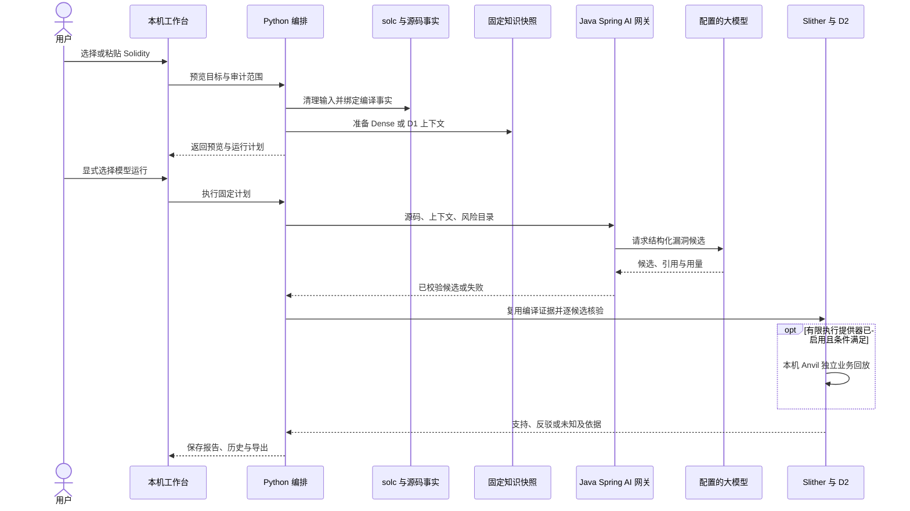

# 技术设计：一条审计结论怎样产生

VeriRAG 把审计分成两个阶段：先提出可以定位到代码的漏洞猜想，再检查程序证据是否支持这条猜想。Python 组织这条流程，Java 提供结构化模型网关；工作台和命令行共用分析入口。

如果希望先理解 D1、D2 和报告状态，请读 [概念与案例导读](releases/R2-20261010/attachments/CONCEPTS_AND_WALKTHROUGH.md)。本页解释当前源码如何实现这些机制，目标方案另见 [R2 设计](releases/R2-20261010/PROPOSED_DESIGN.md)。

## 为什么使用 Java 与 Python

Java 21 使用 Spring Boot 4.1.1 的依赖体系和 Spring AI 2.0.1，负责供应商配置、模型调用、严格输出协议、超时与命令行接口。CLI 不启动 Spring 容器，也没有另一个 Java Web 服务。Python 负责本机 HTTP 服务、运行计划、批量编排和单写者运行控制，还负责较多变的源码遍历、工具适配、EVM 回放与统计。

这种分工让模型协议集中在 Java，研究机制集中在 Python。两侧通过子进程参数及结构化 JSON 交换数据。Java 检索 CLI 也提供三策略与条件绑定实现，Python 有运行和回退入口；对应配对数量、上下文内容和状态通过一致性检查核对。并发入口与工作台锁位于 Python，不能把所有并发控制归到 Java。

## 一次真实模型审计的时序

Vanilla 模型不接收检索资料。离线演练直接输入登记候选，跳过模型交互；合成模拟只读取夹具，连 D2 也不执行。含依赖项目需提供完整编译模板，语法回退只能展示受限结构。

## 输入：让模型与工具分析同一份程序

`evaluation_input.py` 保留原件，清理可能泄露答案的注释，并用空白保持行列；字符串内容原样保存。源码摘要是字节内容的 SHA-256 校验值，用于发现输入是否变化。原件和清理后输入分别登记摘要。

`audit_target.py` 校验预置或粘贴目标。`program_facts.py` 可以提取受限的函数、调用、状态写入和 CEI 顺序；这种语法结构不具备真实编译器 AST 的全部语义。发现流程不按评分真值选择风险行，给定候选核验显式使用 `CLAIM_VALIDATION`。现有探索实验仍有给定漏洞类别先验，也不能消除模型训练中的潜在数据污染。

`tool_environment.py` 取源码全部有效 `pragma` 的版本交集，选择固定 solc。`compiler_facts.py` 使用 standard-json（Solidity 编译器的结构化输入输出协议），绑定全部源码依赖、编译设置、版本、二进制、AST、ABI 入口和产物；实际重编译后比较完整 JSON。缺依赖、编译器变化或产物不符会阻止证据被继续使用。

## D1：检索、配对与模型消费

当前本机 Nomic 快照使用 768 维向量，包含 300 组、600 条自动标注知识。Dense 与 D1 从同一个固定池选择案例，Vanilla 不向模型传入检索内容。Milvus 是可重建的向量索引，知识快照是案例事实来源。

`d1_consumption.py` 与 Java `AutomaticContrast` 从保存全文提取机制变化窗口，过滤纯改名、多义或不完整配对。Java／Python 最多使用两对，上下文最多 4096 UTF-8 字节；字节限制尚不能证明精确 token 公平。自动配对适用性保留未知。

`HypothesisService` 的 `hypotheses-v4-diff-guidance` 提示引导模型比较权限、同资源写入和调用顺序。参考修复片段不替代待审源码。最终请求回执记录系统提示、源码、上下文、其他指令、消息封装和输出的预算组成。

`focus_context.py` 生成函数、修饰器、传递内部调用和状态声明的原字节索引，代码字段分别为 `ff/fm/fi/fv`。`check_templates.py` 组织 10 条有知识来源的检查模板，按入口、资源和路径保守实例化。当前全文输入及默认 D1 配对保持原方式，焦点与模板的展示能力尚不能证明模型效果提升。间接函数指针、递归、未知实现等会登记缺口，`SYNTAX_ONLY` 只表示语法可读。

## Java 网关：把自由回答变成可检查的候选

2026-10-16 接入 R3 的显式实验路径：`r3_retrieval.py` 为冻结原件生成独立机制卡片，原快照仍保留代码对。代码向量与代码、函数名目的代理、行为三路 BM25 分别搜索完整知识侧，再合并完整配对。新并集同时供向量排序与倒数名次融合使用，保留各路排名、增量案例、条件冲突和互补选择回执。资源归属键冲突会排除案例，未知路径和状态版本不会变成适用性证明。当前 145 张卡片均未独立语义审核，只能显式用于工程探索；默认工作台仍沿用原检索路径。

`r3_cli.py` 沿用 `benchmark_batch.py` 保存五条件结果。代码与卡片表达共享案例顺序；并集排序共享新池身份。每个实际请求先通过 Java 本机重放，冻结完整消息摘要；`maxPromptBytes` 可在供应商调用前限制系统与用户提示总 UTF-8 字节数。该预算不包括尚未核实的消息封装 token 开销，不能宣称精确 token 公平。卡片与条件回执只指导提出候选，D2 继续使用当前源码、编译与工具证据。

`HypothesisCli` 调用 `HypothesisService`，最多接受三项结构化假设，并核对合约、完整函数签名、风险操作、代码位置和引用。名称、位置或类型不匹配时保存失败原因。模型没有提供用量时，界面显示未知，数据层处理见 [运行审计附录](releases/R2-20261010/attachments/OPERATIONS_AND_REPRODUCIBILITY.md)。

风险目录用于让模型引用实际编译操作。发现阶段和候选核验阶段优先复用同一编译收据；多合约通过显式目标投影区分。2026-10-13 的全部新候选曾因跨阶段身份失配等原因未知，后续修复实现了同收据复用，历史正式报告仍保留当时的结果。

## D2：从候选走到证据结论

### 绑定准确的风险位置

`risk_binding.py` 依次尝试精确行、同一语句的真实 UTF-8 字节跨度、±2 行窗口，且必须找到同合约、同入口、同机制的唯一操作。报告同时保留候选原行和实际绑定行，多义、错操作或错来源无法绑定。

`bound_slither.py` 通过官方 Slither 适配器独立生成工具收据，核对源码依赖、设置、AST、ABI 和字节码。只有两份收据匹配，工具告警才能佐证候选。Java `ToolAnalyzer` 负责 Slither 与可选 Mythril 子进程协议；可选工具不等于每次审计都执行。

### 检查六项保护和相关路径

`compiled_d2.py` 从类型化 AST 展开内部调用和受支持修饰器，构建 CFG（控制流图，即可能执行顺序的图）。检查点需要支配风险操作，也就是所有相关执行路径先经过检查。资源按实际声明、映射键、结构字段和状态版本比较。

`candidate_proofs.py` 检查有限权限委派与相关入口；`reentrancy_proofs.py` 检查 CEI、统一锁、合法入账状态和正常退出；`access_call_proofs.py` 为终止调用提供有限访问条件反例。`d2_verify.py` 将它们组织为六项检查和最终候选结论。

支持候选需要受支持范围内可行、正常提交的反例，并有匹配的同类工具佐证。反驳候选要求六项保护、相关入口和状态关系完整。局部路径被阻断，只说明这条路径在给定条件下无法到达；相关入口尚有遗漏时，整条候选仍可能未知。

### 有限本机执行补充什么

`evm_witness.py` 的提供器需要显式启用。它消费固定字节码与双收据，在独立回环 Anvil 上按固定 Istanbul 规则运行正常业务序列，独立部署两次并比较指令轨迹、存储与持久提交。资金初态由合法业务交易产生，区块时间由实际业务交易消费。

辅助调用要绑定实际部署实现和正常返回。权限写入要确实改变紧前权限，并由读取同权限槽的敏感入口实际消费。这些检查避免把日志名称、任意余额或无关写入误当证明。有限执行仅补充具体属性反例，不能把不完整静态范围改成完整保护证明。

### 当前语义覆盖到哪里

| 已处理范围 | 仍会产生未知的情况 |
|---|---|
| 内部调用、单占位符修饰器、有限分支与相关入口 | 循环、动态调用、未覆盖入口、交易可行性缺口 |
| storage 根／键／字段与匹配 SlithIR 引用链交叉核对 | 多定义、memory 副本、重赋值和未绑定存储引用 |
| 同次调用的 `now` 与 `block.timestamp`、独立 `block.number`、精确单位和有限搜索 | 未知返回值、复杂初始状态或搜索预算不足 |
| 编译类型确认的旧内置别名、Throw、现代 CALL 布尔返回解构 | 未支持的解构、未知实现或回滚路径 |
| 无转账的绑定查询或辅助调用，在明确正常返回前提下的退出路径 | 实际实现、地址、回调或正常提交证据不足 |
| 真实 SimpleDAO 候选和若干有限重入／权限例子 | RabbitHole 初始化／继承、Atomic 跨合约 token／回调，以及 solc 0.4.9 协议兼容缺口 |

## 报告、复核与工作台

`audit_workbench.py` 固定预览、计划与运行事件；`local_ui.py` 提供本机 HTTP；`agent.html` 及 `agent.js` 展示源码、检索对照、候选、六项检查和只读历史。报告使用 `schemaVersion=2`，旧历史只读。`HYPOTHESES_REFUTED` 表示已提出假设被排除，`NO_CONFIRMED_FINDINGS` 表示没有确证发现；两者都有限定对象。

`evidence_review.py` 独立从重验 AST 核对引用、入口、操作、资源和完整范围，生成通过、冲突或未决的侧报告。它目前不改写 D2 三态，字段为 `gateApplied=false`。`real_fix_check.py` 检查真实维护者补丁的双向结论，`synapse_protocol.py` 区分一次采集与待审的多因素研究协议。

`audit_runner.py` 与 `tool_replay.py` 重新核验保存候选；`four_arm_report.py` 对同候选生成四臂比较；`research_review.py` 和 `d1_research_check.py` 核对候选身份、来源和提示消费。没有独立候选真值时，四臂的混淆矩阵尚无法计算。

`eval_ragas.py` 从冻结批次导出实际检索文本、顺序与模型原候选，核对输入收据后，用独立人工相关性表计算排序指标。`ragas_judge.py` 通过 Ragas 0.4.3 生成可选语义侧报告；端点、模型、凭证环境变量和请求上限均须显式指定。失败分数和缺失用量保留空值，评估不写回模型候选或 D2。忠实度证据包含待审源码与历史案例，参考答案不由原数据集标签自动合成。操作与指标限制见 [Ragas 评估说明](releases/R2-20261010/attachments/RAG_EVALUATION.md)。

## 数据位置与恢复

公开源码直接读取根目录 `smartbugs-curated/` 与 `SolidiFI-benchmark/`；额外对照位于 `data/controls/openzeppelin/`。当前批量保留原 53 个目标编号与标签，SolidiFI 没有自动并入批量。29 个目标因恢复原始空白改变输入摘要，新输入建立新计划，历史结果使用保存输入。

本机环境在 `.local/`，下载仓库在 `data/external/`，权威研究原件在 `research-artifacts/`，关键验证在 `.evidence/`。`storage.read_artifact()` 读取原件或 gzip 并核对还原字节；历史迁移保留逻辑路径。详见 [数据说明](../../data/README.md)、[原件说明](../../research-artifacts/README.md) 和 [运行审计附录](releases/R2-20261010/attachments/OPERATIONS_AND_REPRODUCIBILITY.md)。

## 运行与检查入口

[快速上手](releases/R2-20261010/attachments/GETTING_STARTED.md) 给出三条命令、合成演示和真实 SimpleDAO 演练。完整 CLI 参数、编译清单与路径核验见 [工具说明](../../tools/experiment/README.md)。当前能力与实验结果分别见 [进度](PROGRESS.md)、[实验看板](releases/R2-20261010/attachments/EXPERIMENT_DASHBOARD.md)，逐项验收保留在 [R2 验收](releases/R2-20261010/VERIFICATION.md)。
